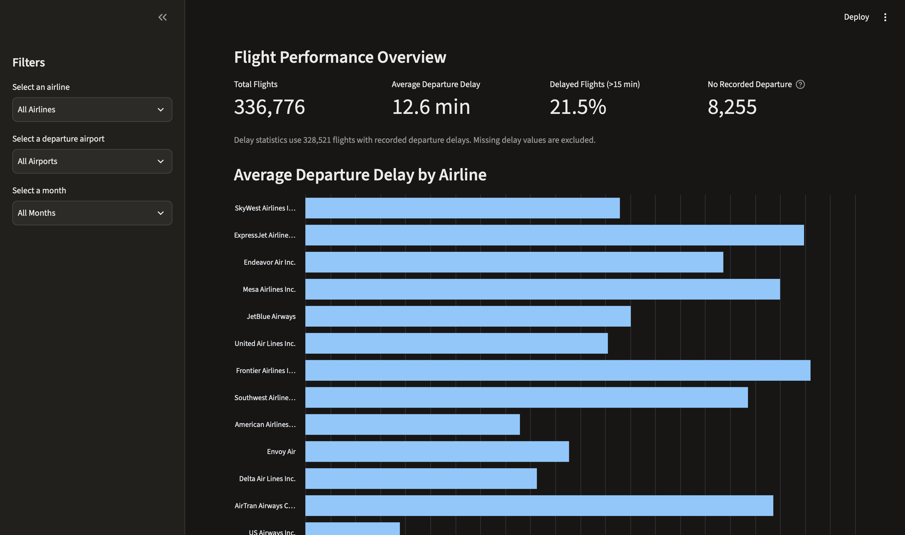

# ✈️ FlightOps Lite
🌐 **[Live Demo](https://flightopsliteaddy1601.streamlit.app/)**

 

An interactive airline performance analytics dashboard built with Python, Pandas, and Streamlit.

## Overview

FlightOps Lite analyzes 336,776 historical flights departing from New York City's JFK, LaGuardia, and Newark airports during 2013.

The application allows users to explore airline performance, identify flight delay trends, and download filtered flight records.

## Features

- Interactive filters for airlines, airports, and months
- Flight counts and average departure delays
- Percentage of flights delayed by more than 15 minutes
- Records with missing departure information
- Airline performance comparison chart
- Monthly departure delay trends
- Downloadable CSV reports
- Missing-data and empty-results handling

## Technologies

- Python
- Pandas
- Streamlit
- nycflights13

## Dataset

Source: nycflights13, based on U.S. Bureau of Transportation Statistics flight records.

The dataset contains 336,776 flights departing NYC airports in 2013.

Flights without recorded departure-delay values are excluded from delay averages and delayed-flight percentage calculations.

## Run Locally

1. Clone this repository.
2. Create and activate a Python virtual environment.
3. Install dependencies:

   pip install -r requirements.txt

4. Launch the dashboard:

   streamlit run app.py

## Future Improvements

- More advanced performance metrics
- Flight-delay prediction using machine learning
- Additional datasets and years
- Improved visualizations

## Author

Aditya Rajiv Sharma
